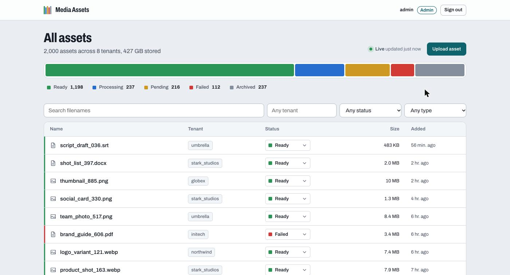
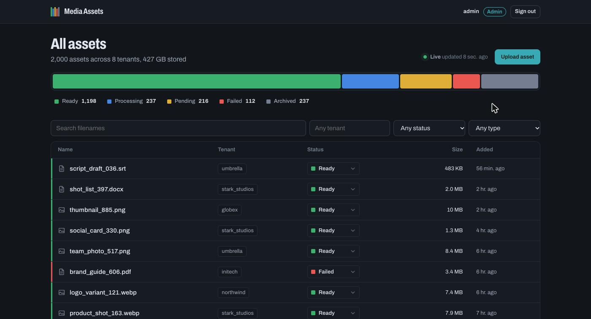

# Real-time Media Asset Dashboard

A full-stack dashboard for tracking media assets (video, audio, images, documents) as they're ingested, processed and archived across many tenants. Files go straight from the browser to S3 through presigned URLs, every change lands in an audit trail, and the search is indexed so it stays fast at hundreds of thousands of rows.



<details>
<summary>Dark theme</summary>



</details>

## Features

- **Live pipeline view.** A status strip shows where every asset sits (ready, processing, pending, failed, archived), and clicking a segment filters the table to that status. The dashboard refreshes every 10 seconds while the tab is visible.
- **Search and filter** by filename, tenant, status and type, with pagination. Filters live in the URL, so links and the back button keep the same view.
- **Direct-to-S3 uploads** with drag and drop and a progress bar. File bytes never pass through the API server.
- **Downloads** through short-lived presigned URLs that keep the original filename.
- **Audit history** for every asset: created, upload confirmed or failed, and each status change with who made it.
- **Role-based access:**

  | Role   | Browse & download | Upload & change status | Delete |
  | ------ | :---------------: | :--------------------: | :----: |
  | viewer | ✓                 |                        |        |
  | editor | ✓                 | ✓                      |        |
  | admin  | ✓                 | ✓                      | ✓      |

  Self-registration always creates a **viewer**. Editor and admin accounts are provisioned separately, so nobody can sign themselves up as an admin.

## Stack

| Layer    | Tech |
| -------- | ---- |
| API      | Node.js, Express 5, MySQL 8 (`mysql2`), JWT (`jsonwebtoken`, `bcryptjs`) |
| Storage  | AWS S3, using presigned PUT/GET URLs |
| Frontend | React 19, React Router 7, Vite. Plain CSS with light and dark themes, no UI library |
| Deploy   | AWS Lambda + API Gateway HTTP API via `serverless-http` and AWS SAM. Logs go to CloudWatch |
| Tests    | `node:test` integration tests against real MySQL and an S3-compatible mock |

## How an upload works

```
Browser                         API (Express)                    MySQL          S3
   │  POST /api/assets              │                               │              │
   │ ─────────────────────────────► │  INSERT asset (pending) + log │              │
   │                                │ ─────────────────────────────►│              │
   │  { id, presigned PUT url }     │  sign PUT url                 │              │
   │ ◄───────────────────────────── │                               │              │
   │  PUT file bytes ──────────────────────────────────────────────────────────►   │
   │  POST /api/assets/:id/confirm-upload                           │              │
   │ ─────────────────────────────► │  HeadObject: real size ─────────────────────►│
   │                                │  UPDATE ready + size + log ──►│              │
```

If the browser's PUT fails, it calls `POST /api/assets/:id/upload-failed`, so the asset is marked failed instead of sitting in "pending" forever. The recorded size always comes from S3, never from the client.

## Running locally

You need Node 20+ and Docker. `docker-compose.yml` starts MySQL and [Adobe S3Mock](https://github.com/adobe/S3Mock), an S3-compatible server, so the full upload flow works without an AWS account.

```bash
# 1. Infrastructure: MySQL loads schema.sql on first start; S3Mock creates the bucket
docker compose up -d

# 2. API
cd backend
npm install
cp .env.example .env          # defaults match docker-compose; set a JWT_SECRET
npm run seed                  # demo accounts + 2,000 sample assets
npm run dev                   # http://localhost:3001

# 3. Frontend (second terminal)
cd frontend
npm install
npm run dev                   # http://localhost:5173
```

In development, Vite proxies `/api` to the API, so there's no CORS setup. The login page lists the seeded demo accounts, which are for local use only:

| Username | Password     | Role   |
| -------- | ------------ | ------ |
| `admin`  | `admin1234`  | admin  |
| `editor` | `editor1234` | editor |
| `viewer` | `viewer1234` | viewer |

## Tests

```bash
cd backend
npm test
```

There are 22 integration tests. They run against the real MySQL and S3Mock containers, use their own tenant and users, and clean up after themselves. They cover:
- auth, including that registration can't escalate roles and that a tampered token is rejected
- the full role matrix
- input validation
- the full presigned upload → confirm → download flow
- search, pagination and stats
- audit entries
- admin delete, which removes the row, its history and the S3 object

The frontend is checked with `npm run lint` (oxlint) and `npm run build`.

## Search performance

The main dashboard query, *one tenant's assets in one status, newest first*, is served by a composite index on `(tenant_id, status, created_at)`. With that index MySQL can seek directly to the matching rows already in order, instead of scanning the whole table and sorting.

The benchmark is reproducible:

```bash
cd backend
npm run seed -- --rows 160000 --reset
npm run bench
```

Measured on 160,000 rows (MySQL 8.4 in Docker on an Apple-silicon laptop, 200 queries per variant):

| Variant                    | avg      | p50      | p95      | MySQL access |
| -------------------------- | -------- | -------- | -------- | ------------ |
| No index (full scan + sort) | 36.4 ms | 35.8 ms  | 39.7 ms  | `ALL`        |
| Composite index            | 1.85 ms  | 1.82 ms  | 2.63 ms  | `ref`        |

That's a **~95% lower average latency, about 20× faster**. The timings include the client round trip, so the time spent inside MySQL drops by even more. Two further indexes cover the views without a tenant filter: the default "newest first" list (`created_at`), and status-only filters plus per-status totals (`status, created_at, file_size`).

## API

All `/api/assets` routes need `Authorization: Bearer <token>`.

| Method | Path | Who | Purpose |
| ------ | ---- | --- | ------- |
| POST | `/api/auth/register` | anyone | Create a viewer account |
| POST | `/api/auth/login` | anyone | Get a JWT (valid 24h) |
| GET | `/api/auth/me` | signed in | Current user |
| GET | `/api/assets?tenant_id=&status=&asset_type=&q=&page=&pageSize=` | all roles | Search with pagination |
| GET | `/api/assets/stats?tenant_id=` | all roles | Counts and bytes per status |
| GET | `/api/assets/tenants` | all roles | Tenant ids, for autocomplete |
| GET | `/api/assets/:id` | all roles | Asset metadata |
| GET | `/api/assets/:id/logs` | all roles | Audit history |
| GET | `/api/assets/:id/download-url` | all roles | Presigned GET URL (5 min) |
| POST | `/api/assets` | editor, admin | Create asset and get a presigned PUT URL |
| POST | `/api/assets/:id/confirm-upload` | editor, admin | Verify in S3 and mark ready |
| POST | `/api/assets/:id/upload-failed` | editor, admin | Mark a pending upload failed |
| PATCH | `/api/assets/:id/status` | editor, admin | Change status (audited) |
| DELETE | `/api/assets/:id` | admin | Delete row, history and S3 object |
| GET | `/api/health` | anyone | API and database health |

Errors are always `{ "error": "message" }`. Unexpected errors return a generic 500 message, and the details are logged on the server only.

## Deploying to AWS (Lambda + API Gateway + S3)

You need the [AWS SAM CLI](https://docs.aws.amazon.com/serverless-application-model/latest/developerguide/install-sam-cli.html) and credentials that can create Lambda, API Gateway, S3 and IAM resources.

```bash
cd backend
sam build
sam deploy --guided   # asks for DB settings, JwtSecret (≥32 chars) and CorsOrigin
```

`template.yaml` provisions:
- An S3 bucket whose CORS rules allow only your frontend origin. The Lambda gets an IAM policy scoped to that bucket.
- A Lambda running the Express app through `src/lambda.js`, behind an HTTP API catch-all route. It runs with `NODE_ENV=production`, so the API refuses to start without a `JWT_SECRET`.
- A CloudWatch log group, which Lambda creates automatically.

Build the frontend with `VITE_API_URL=https://<api-id>.execute-api.<region>.amazonaws.com/api npm run build` and host `frontend/dist` on any static host (S3 + CloudFront, Netlify and so on).

**Notes:**
- If MySQL is on RDS inside a VPC, add `VpcConfig` (subnets plus a security group that can reach the database) to the function. That's environment-specific, so it isn't hard-coded.
- The live view uses polling instead of WebSockets because API Gateway HTTP APIs and Lambda can't hold long-lived connections.
- This deploy path hasn't been run against a live AWS account yet. Check the `sam deploy` output and test the endpoints before relying on it.

## Project layout

```
backend/
  src/app.js              Express app, CORS, error handler
  src/routes/             auth + assets routes
  src/config/             MySQL pool (with transaction helper), S3 client
  scripts/seed.js         demo users and synthetic assets
  scripts/benchmark.js    index benchmark
  test/                   integration tests
  template.yaml           AWS SAM template
frontend/
  src/pages/              Dashboard, AssetDetail, Login, Register
  src/components/         status strip, upload drawer, table pieces
  src/api/client.js       API client, including XHR upload with progress
schema.sql                tables and indexes
docker-compose.yml        local MySQL + S3Mock
```
